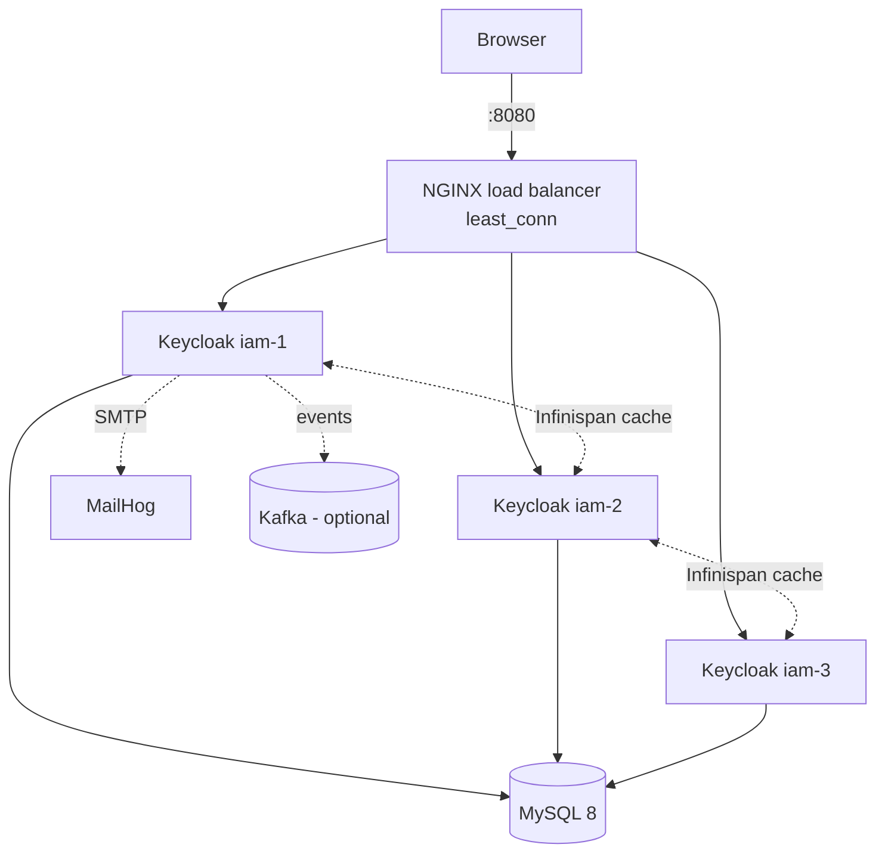

# Keycloak in Practice

A hands-on Keycloak 26 project that goes beyond "run the container":

- **A highly available cluster**: 3 Keycloak nodes behind an NGINX load balancer, sharing sessions through Infinispan.
- **An optimized, custom Docker image**: themes and Java extensions are compiled and baked in at build time.
- **A custom login and email theme** (`greshfi`): rebranded with CSS only, so it stays upgrade-safe.
- **A custom Java extension (SPI)**: a Kafka event listener that streams Keycloak events such as logins and failed logins to a Kafka topic.

📘 **Want the full story?** [docs/Keycloak-in-Practice.pdf](docs/Keycloak-in-Practice.pdf) is a 30-page guide with every design decision, the gotchas hit along the way, and the complete source.

---

## Contents

1. [Architecture](#architecture)
2. [Project layout](#project-layout)
3. [Quick start](#quick-start)
4. [The optimized Dockerfile](#the-optimized-dockerfile)
5. [Docker Compose: the cluster](#docker-compose-the-cluster)
6. [Configuration (.env)](#configuration-env)
7. [The custom theme](#the-custom-theme)
8. [The Kafka event listener (SPI)](#the-kafka-event-listener-spi)
9. [Useful commands](#useful-commands)
10. [Tech stack](#tech-stack)

---

## Architecture



- **NGINX** spreads traffic across the three nodes and skips a node for 5 s if it fails.
- **Keycloak nodes** are identical copies of the same custom image.
- **Infinispan** (built into Keycloak) shares sessions between nodes, so a user stays logged in even if the node they were on goes down.
- **MySQL** stores realms, users and clients. The nodes also use it to **find each other** (`jdbc-ping`), so no multicast networking is needed.
- **MailHog** catches outgoing emails locally (verify email, reset password…).
- **Kafka** (optional) receives login events from the custom extension.

---

## Project layout

```
keycloak-setup/
├── Dockerfile                  optimized multi-stage build (see below)
├── docker-compose.yaml         nginx-lb, iam-1, iam-2, iam-3, database, mailhog
├── .env                        sample configuration (keys + example values)
├── .dockerignore               keeps .env, .git, target/ … out of the image
├── nginx-lb/
│   └── default.conf            load balancer config
├── pom.xml                     parent Maven project (2 modules)
├── keycloak-theme/             MODULE 1: login + email theme (files only, no Java)
│   └── src/main/resources/
│       ├── META-INF/keycloak-themes.json
│       └── theme/greshfi/
│           ├── login/          theme.properties, CSS, logo, favicon, messages
│           └── email/          theme.properties, html/template.ftl, messages
├── keycloak-cutomization/      MODULE 2: Java extension (Kafka event listener)
│   ├── pom.xml
│   └── src/main/
│       ├── java/com/todimu/keycloak/events/
│       │   ├── KafkaEventListenerProviderFactory.java
│       │   ├── KafkaEventListenerProvider.java
│       │   └── KafkaEventPublisher.java
│       └── resources/META-INF/services/
│           └── org.keycloak.events.EventListenerProviderFactory
└── docs/
    └── Keycloak-in-Practice.pdf
```

---

## Quick start

**Requirements:** Docker with Docker Compose. You don't need Java or Maven locally, because the Docker build compiles everything.

```bash
# 1. clone
git clone https://github.com/Oluwatodimu/keycloak-setup.git
cd keycloak-setup

# 2. build the custom Keycloak image (compiles the theme + extension inside Docker)
docker build -t todimuisewon/customized-iam-customized:v1.0.0 .

# 3. start everything
docker compose up -d

# 4. watch the nodes start (wait for "Listening on: http://0.0.0.0:8080")
docker compose logs -f iam-1 iam-2 iam-3
```

Then open **http://localhost:8080** and sign in with the admin user from `.env`.

**Turn on the custom pieces** (per realm, in the admin console):

| What | Where |
|---|---|
| Custom login page | Realm settings → Themes → Login theme → `greshfi` |
| Custom emails | Realm settings → Themes → Email theme → `greshfi` |
| Send emails to MailHog | Realm settings → Email → host `mailhog`, port `1025`, then open http://localhost:8025 |
| Kafka events (optional) | Realm settings → Events → Event listeners → add `kafka` |

---

## The optimized Dockerfile

Keycloak can start in two ways:

- `start-dev` is easy but slow and not for production.
- `start --optimized` is fast and production-ready, but it needs all build-time options (database type, features, extensions) to be **baked into the image in advance** with `kc.sh build`.

This Dockerfile does exactly that, in **three stages**:

```dockerfile
# ── Stage 1: compile our code ──────────────────────────────────────────
FROM maven:3.9.6-eclipse-temurin-21 AS MAVEN_BUILD
COPY ./ ./
RUN mvn clean package            # builds keycloak-theme.jar + keycloak-cutomization.jar

# ── Stage 2: build an optimized Keycloak ───────────────────────────────
FROM quay.io/keycloak/keycloak:26.7.3 AS builder
ENV KC_HEALTH_ENABLED=true        # /health endpoints on port 9000
ENV KC_METRICS_ENABLED=true       # /metrics endpoint on port 9000
ENV KC_FEATURES=token-exchange,admin-fine-grained-authz
ENV QUARKUS_TRANSACTION_MANAGER_ENABLE_RECOVERY=true
ENV KC_DB=mysql                   # database vendor is a build-time option
WORKDIR /opt/keycloak
COPY --from=MAVEN_BUILD ./keycloak-theme/target/*.jar /opt/keycloak/providers
COPY --from=MAVEN_BUILD ./keycloak-cutomization/target/keycloak-cutomization-*.jar /opt/keycloak/providers/
RUN /opt/keycloak/bin/kc.sh build # bakes DB, features and our jars into the server

# ── Stage 3: small runtime image ───────────────────────────────────────
FROM quay.io/keycloak/keycloak:26.7.3
COPY --from=builder /opt/keycloak/ /opt/keycloak/
EXPOSE 8080 9000 8443
ENTRYPOINT ["/opt/keycloak/bin/kc.sh", "start", "--optimized",
            "--http-enabled=true", "--proxy-headers=xforwarded"]
```

| Stage | Why it exists |
|---|---|
| **1. Maven** | Compiles the theme and the Java extension. You don't need Maven installed, and the build tools never end up in the final image. |
| **2. Builder** | Copies the jars into `providers/` and runs `kc.sh build`. Keycloak does its expensive setup once, here, instead of on every container start. |
| **3. Runtime** | Copies only the finished Keycloak. It starts with `--optimized`, so startup is fast and no build step runs at runtime. |

Two runtime flags matter for running behind NGINX:

- `--http-enabled=true`: NGINX talks to Keycloak over plain HTTP inside the Docker network.
- `--proxy-headers=xforwarded`: Keycloak trusts the `X-Forwarded-*` headers NGINX sends, so it builds correct URLs and sees the real client IP.

> **Rule of thumb:** changing a theme or the Java code means **rebuilding the image**. Changing `.env` only needs a **restart**.

---

## Docker Compose: the cluster

`docker-compose.yaml` runs six services on one private network (`iam-network`):

| Service | Image | Role | Port on your machine |
|---|---|---|---|
| `nginx-lb` | `nginx:1.27-alpine` | Load balancer in front of the 3 nodes | **8080** |
| `iam-1`, `iam-2`, `iam-3` | the custom image built above | Keycloak cluster nodes | none (only reachable through NGINX) |
| `database` | `mysql:8.0.39` | Shared database, persistent volume `iam-volume` | 3306 |
| `mailhog` | `mailhog/mailhog` | Fake SMTP server + web inbox | 1025 (SMTP), **8025** (inbox) |

**How the pieces fit:**

- **Every node reads the same `.env`** (`env_file: .env`), so they share one configuration.
- **Nodes wait for MySQL** to be healthy before starting (`depends_on … condition: service_healthy`).
- **Clustering** is switched on by two settings in `.env`:
  - `KC_CACHE=ispn` turns on distributed caches (sessions are shared).
  - `KC_CACHE_STACK=jdbc-ping` lets nodes discover each other through a table in MySQL, so no extra discovery service is needed.
- **Load balancing** (`nginx-lb/default.conf`):

```nginx
upstream keycloak_nodes {
    least_conn;                                      # send to the least busy node
    server iam-1:8080 max_fails=1 fail_timeout=5s;   # skip a failing node for 5s
    server iam-2:8080 max_fails=1 fail_timeout=5s;
    server iam-3:8080 max_fails=1 fail_timeout=5s;
}

server {
    listen 80;
    location / {
        proxy_pass http://keycloak_nodes;
        proxy_set_header Host              $host;
        proxy_set_header X-Forwarded-Host  $http_host;
        proxy_set_header X-Forwarded-Proto $scheme;
        proxy_set_header X-Forwarded-Port  $server_port;
        proxy_set_header X-Real-IP         $remote_addr;
    }
}
```

**Try the high availability:** log in, stop one node, and refresh. You should still be logged in.

```bash
docker compose stop iam-1        # or: docker compose kill iam-1 (simulate a crash)
docker compose up -d iam-1       # bring it back
```

---

## Configuration (.env)

`.env` is committed **with sample values only** so you can see every key. Replace the values with your own before using this anywhere real.

| Key | What it does |
|---|---|
| `KC_BOOTSTRAP_ADMIN_USERNAME` / `KC_BOOTSTRAP_ADMIN_PASSWORD` | First admin user, created on first start |
| `KC_DB_URL` / `KC_DB_USERNAME` / `KC_DB_PASSWORD` | MySQL connection (`jdbc:mysql://database:3306/keycloak`) |
| `KC_HOSTNAME` | Public URL of Keycloak (`http://localhost:8080` locally) |
| `KC_CACHE=ispn` | Turn on distributed caching (clustering) |
| `KC_CACHE_STACK=jdbc-ping` | Node discovery through the database |
| `KC_SPI_EVENTS_LISTENER__KAFKA__*` | Kafka event listener settings (see below) |

Keycloak reads any `KC_*` variable as a setting. For extensions, the pattern is `KC_SPI_<SPI>__<PROVIDER>__<PROPERTY>`, e.g. `KC_SPI_EVENTS_LISTENER__KAFKA__TOPIC`.

---

## The custom theme

Module: `keycloak-theme`. Theme name: **`greshfi`**.

### Login pages: inherit, don't copy

Keycloak themes have **parents**. When Keycloak needs a page, it looks in your theme first, then in the parent. So this theme contains **only what it changes**, and every login page (sign-in, register, reset password, OTP, errors…) comes from Keycloak's modern `keycloak.v2` theme. That keeps it **safe to upgrade**: new Keycloak fixes flow through automatically.

```
theme/greshfi/login/
├── theme.properties        parent=keycloak.v2
│                           styles=css/styles.css css/greshfi.css
├── resources/css/greshfi.css   the whole redesign
├── resources/img/          logo (light + dark), favicon
└── messages/messages_en.properties   wording, e.g. loginAccountTitle, usernameOrEmail
```

The redesign is **CSS only**:

- brand colours defined once as CSS variables, with a dark-mode set
- a rounded card, unified rounded inputs and a full-width sign-in button
- error states that stay red even while the field has focus
- the Gresh logo, swapped for a light version in dark mode

Because it styles Keycloak's standard classes, the same look applies to **every** login page.

To show the logo, set the realm's **HTML Display name** to:
```html
<div class="kc-logo-text"><span>Greshfi</span></div>
```

### Emails: one wrapper for all

```
theme/greshfi/email/
├── theme.properties        parent=keycloak
├── html/template.ftl       branded wrapper used by EVERY email
└── messages/messages_en.properties   subjects + wording, emailGreeting=Hi {0},
```

Every email (verify email, reset password, failed-login alert…) is rendered **inside `template.ftl`**:

- a dark header with the logo
- a green accent line
- a white card holding the message
- a personal greeting ("Hi Todimu,")
- a footer

The per-email templates are inherited from Keycloak, and the text comes from the message files. Email apps ignore external CSS, so the styles are inline.

### Registering the theme

`META-INF/keycloak-themes.json` tells Keycloak this jar contains a theme:
```json
{ "themes": [{ "name": "greshfi", "types": ["login", "email"] }] }
```

---

## The Kafka event listener (SPI)

Module: `keycloak-cutomization`.

Keycloak can be extended with Java plugins called **SPIs** (Service Provider Interfaces). This one is an **event listener**: every time something happens in Keycloak (a login, a failed login, a registration…), it publishes a JSON message to Kafka. Other systems can then consume those events for fraud detection, analytics or auditing.

### How an SPI is wired

Every Keycloak extension has the same three parts:

| Part | File | Job |
|---|---|---|
| **Factory** | `KafkaEventListenerProviderFactory.java` | Created **once** at startup. Reads config, creates the shared publisher, hands out providers. `getId()` returns `"kafka"`, the name you pick in the admin console. |
| **Provider** | `KafkaEventListenerProvider.java` | Created **per request**. Receives each event, filters it, turns it into JSON. |
| **Registration** | `META-INF/services/org.keycloak.events.EventListenerProviderFactory` | One line naming the factory class, which is how Keycloak discovers it. |

Plus a helper:

| Part | File | Job |
|---|---|---|
| **Publisher** | `KafkaEventPublisher.java` | Owns the Kafka producer and a background thread that does the actual sending. |

### What happens on each login

```
User logs in
   │
   ▼
Provider.onEvent(event)
   ├─ not in the configured list?  → ignore
   ├─ build JSON, key = userId
   └─ wait until Keycloak's database transaction COMMITS
            │
            ▼
      Publisher.publish()  → puts it on a queue, returns immediately
            │
            ▼  (background thread)
      Kafka producer → topic "keycloak.events"
```

### Design decisions

| Decision | Why |
|---|---|
| **Filter first** | Keycloak calls the listener for *every* event (~130 types); only the configured ones are published. |
| **Publish after commit** | Never announce something that was rolled back. |
| **Background thread + bounded queue** | Logins never wait on Kafka. Without this, a Kafka outage added **~2 s to every login**; with it, logins stay around 50–70 ms. If the queue fills up, events are dropped with a warning instead of using unlimited memory. |
| **Producer created lazily, retried every 30 s** | Keycloak always starts, even if Kafka is down or its hostname doesn't exist yet. It reconnects automatically and reports how many events were dropped. |
| **Key = user ID** | All events for one user land on the same Kafka partition, in order. |
| **`acks=all`, idempotent producer** | No duplicates or silent loss on retries. |
| **SASL support** | Works with secured Kafka (PLAIN or SCRAM-SHA-256/512), e.g. Confluent Cloud, Aiven or MSK. Passwords are never logged. |
| **Class-loader fix** | Keycloak runs on Quarkus with its own class loaders. Kafka (and its SASL login) needs its own loader set while the producer is created. |

### Packaging (`keycloak-cutomization/pom.xml`)

- **Keycloak libraries** are `provided`: Keycloak already has them, so they aren't bundled.
- **`kafka-clients`** is bundled into the jar with the **Maven Shade plugin**, because Keycloak doesn't include Kafka.
- **`slf4j`** is excluded from the bundle (Keycloak ships its own).

### Configuration

| Env var (`KC_SPI_EVENTS_LISTENER__KAFKA__…`) | Default | Meaning |
|---|---|---|
| `BOOTSTRAP_SERVERS` | `kafka:9092` | Kafka broker(s) |
| `TOPIC` | `keycloak.events` | Topic to publish to |
| `EVENT_TYPES` | `LOGIN,LOGIN_ERROR,REGISTER` | Comma list, or `*` for everything |
| `USERNAME` / `PASSWORD` | – | Kafka credentials (turns on SASL) |
| `SASL_MECHANISM` | `PLAIN` | `PLAIN`, `SCRAM-SHA-256`, `SCRAM-SHA-512` |
| `SECURITY_PROTOCOL` | `SASL_SSL` if a username is set | `SASL_PLAINTEXT` for a local broker without TLS |
| `QUEUE_SIZE` | `10000` | Max events waiting to be sent |

### Example message

```
key:     29b96dc2-da20-436e-8a63-39861545f4ed
header:  eventType=LOGIN
{
  "id": "…", "time": 1792181651000, "type": "LOGIN",
  "realmId": "…", "realmName": "greshfi", "clientId": "account-console",
  "userId": "29b96dc2-…", "sessionId": "…", "ipAddress": "172.18.0.8",
  "error": null,
  "details": { "auth_method": "openid-connect", "username": "todimu" }
}
```

### Try it

The compose file doesn't include a Kafka broker. Point `BOOTSTRAP_SERVERS` at any Kafka you have, restart the nodes, and add `kafka` under *Realm settings → Events → Event listeners*. On startup you should see:

```
Kafka event listener ready: servers=kafka:9092 topic=keycloak.events auth=SASL_PLAINTEXT/PLAIN as keycloak eventTypes=[LOGIN, LOGIN_ERROR, REGISTER]
```

---

## Useful commands

```bash
# rebuild after changing the theme or Java code, then restart all nodes
docker build -t todimuisewon/customized-iam-customized:v1.0.0 .
docker compose up -d --force-recreate iam-1 iam-2 iam-3

# logs
docker compose logs -f iam-1 iam-2 iam-3
docker compose logs -f iam-1 | grep -i "kafka event listener"

# check the extensions made it into the image
docker compose exec iam-1 ls /opt/keycloak/providers

# stop everything (add -v to also delete the database volume)
docker compose down
```

**Theme changes not showing?** Keycloak lets browsers cache CSS for a long time. Use an incognito window, or DevTools → Network → *Disable cache*.

---

## Tech stack

Keycloak 26.7.3 · Java 21 · Maven (Shade plugin) · Docker multi-stage builds · Docker Compose · NGINX · MySQL 8 · Infinispan (`jdbc-ping`) · Apache Kafka (SASL) · FreeMarker · PatternFly 5 · CSS

📘 Full guide: [docs/Keycloak-in-Practice.pdf](docs/Keycloak-in-Practice.pdf)
